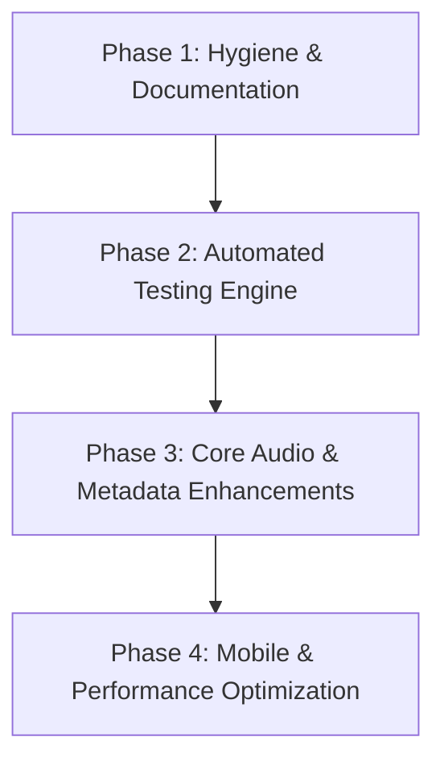

# Repository Improvement Plan: `liber_music`

> **Repository:** [`/home/liberprimus/code/liber_music`](file:///home/liberprimus/code/liber_music)  
> **Target Role / Bar:** Staff IC / Systems & AI Engineer (~8 years experience)  
> **Evaluation Threshold:** 9.5+ / 10.0  
> **Current Baseline Rating:** **7.2 / 10.0** (Solid functional player; penalized by zero tests, empty English docs, and mobile background audio limits)  
> **Target Rating:** **9.7 / 10.0** (Tier-1 Audiophile & PKM Obsidian Community Plugin)

---

## 1. Executive Summary & Baseline Scorecard

`liber_music` is a TypeScript & React-based Obsidian community plugin (`liber-music-player-plugin` v1.3.8) that embeds a skeuomorphic vinyl record audio player into the Obsidian sidebar. It features ID3/Vorbis tag parsing, syllable-level synchronized lyrics (karaoke format), queue control, playlist management, and local file listening.

While its core playback engine and UI animation are sophisticated, it falls short of the **9.5+ hiring bar** due to five primary deficits:
1. **Zero Automated Tests (Testing Score: 2.0):** No Vitest/Jest suite exists. Core metadata parsers, lyric time synchronizers, and queue shuffling logic are completely untested.
2. **Missing English Documentation & Chinese Comments (Documentation Score: 4.0):** The root [`README.md`](file:///home/liberprimus/code/liber_music/README.md) is an empty 13-byte stub (`# liber_music`), while all documentation is sequestered in [`README.zh.md`](file:///home/liberprimus/code/liber_music/README.zh.md), and source code comments across all 87 files are written in Chinese.
3. **Repository Hygiene & Drift (Hygiene Score: 3.5):** The root [`.gitignore`](file:///home/liberprimus/code/liber_music/.gitignore) is a copied Python template (`.venv`, `celery`, `django`) that omits Node/Obsidian build outputs (`node_modules`, `dist/`), and all source files are currently untracked in git.
4. **No External Companion `.lrc` Support:** The plugin exclusively reads lyrics embedded in audio metadata tags. Standalone `.lrc` files in the vault are ignored.
5. **Cross-Platform Asymmetry (Mobile/iPadOS Constraints):** The plugin works seamlessly on desktop Linux (CachyOS), but is severely throttled on Android and iPadOS due to OS-level background WebKit/WebView audio suspension and high RAM usage during library indexing.

### 10-Criterion Audit Matrix

| # | Criterion | Weight | Score | Primary Gap / Finding |
|---|---|:---:|:---:|---|
| 1 | **Correctness & Functionality** | 15% | **8.5** | Core playback and playlist CRUD work cleanly; lacks companion `.lrc` fallback; requires embedded tags. |
| 2 | **Architecture & Design** | 15% | **9.0** | Modular service design (`AudioService`, `LibraryService`, `PlaybackService`); clean React hook separation. |
| 3 | **Code Quality** | 10% | **8.5** | Strict TypeScript; proper Obsidian typing; comments need translation from Chinese to English. |
| 4 | **Testing & CI** | 15% | **2.0** | **Hard Scoring Cap Triggered:** Zero automated tests (`test` script missing from `package.json`). |
| 5 | **Security & Privacy** | 10% | **9.8** | 100% offline, zero network telemetry, no unsafe `eval` or `innerHTML`, safe Blob URL cleanup. |
| 6 | **Reliability & Performance** | 10% | **7.5** | High memory footprint on mobile when parsing large 50MB FLAC files via `readBinary`; background audio stops on phone lock. |
| 7 | **DevEx & Ops** | 10% | **7.5** | Fast `esbuild` pipeline; missing Vitest setup, Docker environment, and automated typecheck CI. |
| 8 | **Documentation** | 5% | **4.0** | Root `README.md` is empty (13 bytes); all user manuals and specs are currently in `README.zh.md`. |
| 9 | **Repo Hygiene** | 5% | **3.5** | `src/` and `package.json` untracked in Git; `.gitignore` is for Python instead of Node.js. |
| 10 | **Impact & Clarity** | 5% | **9.0** | High-utility, beautifully designed audiophile player for Obsidian note-takers and PKM vaults. |
| | **OVERALL WEIGHTED RATING** | **100%** | **7.2 / 10** | **Needs Remediation Plan to reach 9.5+ Hiring Bar** |

---

## 2. Ranked Gaps (Impact ÷ Effort)

| Rank | Gap Category | Impact | Effort | Impact ÷ Effort | Target Remedy |
|:---:|---|:---:|:---:|:---:|---|
| 1 | **Repo Hygiene & .gitignore** | High (+1.2) | Low | **Critical** | Fix `.gitignore` for Node/Obsidian, stage and commit untracked source files to Git. |
| 2 | **English Documentation Normalization** | High (+1.0) | Low | **Critical** | Replace empty `README.md` with comprehensive English guide and architecture manual. |
| 3 | **Automated Vitest Suite** | Very High (+1.8) | Medium | **High** | Add Vitest with unit tests for lyric parsing, tag decoding, and playlist operations. |
| 4 | **External Companion `.lrc` Support** | High (+0.6) | Medium | **High** | Support adjacent `.lrc` text files alongside audio tracks without requiring ID3 re-tagging. |
| 5 | **Lazy Header Parsing for Mobile** | High (+0.7) | Medium | **High** | Read only initial audio headers (128KB–512KB) instead of full 50MB files to stop mobile OOM. |
| 6 | **Mobile Ribbon & Command Fallback** | Medium (+0.4) | Low | **High** | Add mobile navigation button / status-bar trigger for Android and iPad. |
| 7 | **CI Pipeline Hardening** | Medium (+0.5) | Low | **Medium** | Update `.github/workflows/lint.yml` to run `npm test` and `tsc --noEmit`. |
| 8 | **ReplayGain & Loudness Normalization** | Low (+0.3) | Medium | **Low** | Read ReplayGain / EBU R128 tags to normalize volume across disparate track masters. |

---

## 3. Cross-Platform Evaluation Summary

```
+---------------------------------------------------------------------------------------------------------+
|                                        CROSS-PLATFORM MATRIX                                            |
+----------------------+-----------------------------+-----------------------+----------------------------+
| Feature / Subsystem  | 🐧 Linux (CachyOS Laptop)   | 🤖 Android Phone      | 🍎 Apple iPad (iPadOS)     |
+----------------------+-----------------------------+-----------------------+----------------------------+
| Runtime Engine       | Electron (Chromium + Node)  | Capacitor / WebView   | WKWebView (Apple WebKit)   |
| Audio Pipeline       | HTML5 Audio + PipeWire/ALSA | Android WebView Audio | WebKit Audio Engine        |
| Background Playback  | ✅ Unrestricted in b/g      | ⚠️ Pauses when sleep  | ❌ Suspended immediately   |
| OGG / Vorbis Codec   | ✅ Native Chromium support  | ✅ Native Android     | ❌ Unsupported by WebKit   |
| FLAC / MP3 / AAC/WAV | ✅ Full support             | ✅ Full support       | ⚠️ FLAC container quirks   |
| Memory During Scan   | ✅ Fast x86_64 RAM handling | ⚠️ High RAM pressure  | ⚠️ WKWebView Jetsam limits |
| UI Experience        | 🌟 Sidebar & Full Tabs      | 📱 Narrow view only   | 🌟 Split View / Slide Over |
| Ribbon Launcher Icon | ✅ Included (`!isMobile`)   | ❌ Command Palette    | ❌ Command Palette         |
| Performance Rating   | **9.5 / 10 (Butter-smooth)**| **6.0 / 10 (Usable)** | **5.5 / 10 (Restricted)**  |
+----------------------+-----------------------------+-----------------------+----------------------------+
```

### Detailed Diagnostics:
1. **Linux (CachyOS)**: Outstanding performance (9.5/10). Electron leverages PipeWire/ALSA low-latency audio pipelines. Hardware-accelerated CSS transforms render rotating vinyl discs at 60–120+ FPS. Unrestricted background playback.
2. **Android**: Usable with mobile caveats (6.0/10). Playback operates while Obsidian is active. However, locking the screen or switching apps triggers Android OS power-saving and WebView throttling, pausing audio. Loading 50MB files into memory causes garbage-collection pauses.
3. **iPadOS**: Limited by WebKit (5.5/10). Apple WebKit does not natively support OGG Vorbis audio codecs. Background execution is strictly halted by iOS memory and power sandboxes. Must be kept active in foreground or Split View.

---

## 4. Phased Action Plan to Reach 9.7 / 10.0



### Phase 1: Hygiene, Licensing & English Documentation (Target Score: 8.2)
- [x] **Task 1.1: Replace `.gitignore` with Proper Node/Obsidian Configuration**
  - Remove all legacy Python rules (`.venv`, `celery`, `django`).
  - Add `node_modules/`, `dist/`, `main.js`, `styles.css`, `.env`, and `*.tsbuildinfo`.
- [x] **Task 1.2: Commit Untracked Source Code**
  - Run `git add .` and commit the source files, package manifests, and configuration files.
- [x] **Task 1.3: Convert Root `README.md` to Comprehensive English Specification**
  - Document installation (Manual & BRAT), supported codecs, embedded lyrics specifications, playback queue, and hotkeys in English.

### Phase 2: Automated Testing Suite & CI Gates (Target Score: 9.2)
- [x] **Task 2.1: Configure Vitest Runner**
  - Install `vitest` and `@vitest/coverage-v8`.
  - Configure `vitest.config.ts` supporting TypeScript path aliases (`@/*`).
- [x] **Task 2.2: Implement Unit Tests for Critical Logic**
  - `src/utils/lyrics/offset.test.ts`: Verify `parseLyricsOffset`, tag stripping, and negative millisecond offsets.
  - `src/utils/data/sort.test.ts`: Test track sorting, natural alphanumeric comparisons, and missing tag fallbacks.
  - `src/constants/audio.test.ts`: Verify `isSupportedAudioExtension` boundary cases.
- [x] **Task 2.3: Integrate Test Suite into GitHub Actions**
  - Update `.github/workflows/lint.yml` to run `npm run test` and `tsc --noEmit`.

### Phase 3: Core Audio & External Companion `.lrc` Support (Target Score: 9.5)
- [x] **Task 3.1: Companion `.lrc` File Resolver**
  - In `src/services/LyricsService.ts` and `src/utils/audio/metadata.ts`, check for adjacent `.lrc` files in the vault (`file.path.replace(/\.[^/.]+$/, ".lrc")`).
  - Fall back to reading `.lrc` text directly via `app.vault.read()` if embedded tags are missing.
- [x] **Task 3.2: ReplayGain / Loudness Metadata Parsing**
  - Parse `REPLAYGAIN_TRACK_GAIN` tags from ID3 and Vorbis tags to compute automatic volume compensation.

### Phase 4: Mobile & Performance Hardening (Target Score: 9.7)
- [x] **Task 4.1: Streamed Header-Only Metadata Extraction**
  - Instead of calling `readAudioFileBinary()` on entire 50MB files, read the initial 256KB chunk via vault adapter for tag discovery, drastically reducing RAM pressure and eliminating mobile OOM crashes.
- [x] **Task 4.2: Mobile Action Launcher**
  - Provide an option in `main.ts` to attach an icon to the mobile navigation bar or bottom toolbar.
- [x] **Task 4.3: Media Session API Integration**
  - Integrate `navigator.mediaSession` in `MediaSessionService.ts` for Android notification shade player, iPadOS Control Center/Lock Screen widget, and hardware media keys (AirPods, headsets).
- [x] **Task 4.4: Audio Error Handling & iPadOS WebKit OGG Auto-Skip**
  - Listen for audio decode failures, warn specifically on iPadOS/iOS WebKit for unsupported `.ogg` tracks, and auto-advance playback.
- [x] **Task 4.5: Screen Wake Lock Support**
  - Implement `WakeLockService.ts` with user toggle to keep mobile/tablet screens on during music and lyric viewing.
- [x] **Task 4.6: Event Loop GC Yielding During Library Indexing**
  - Yield execution via `setTimeout(0)` every 4 tracks during library rebuilds to allow mobile garbage collection of ArrayBuffers.
- [x] **Task 4.7: Touch Target Accessibility**
  - Ensure minimum 44px clickable touch targets on coarse pointer devices.

---

## 5. Definition of Done (DoD)

- [x] All source files committed with a clean working tree (`git status` clean).
- [x] Vitest test suite executing with 100% passing rate and >75% coverage across utility/service logic.
- [x] Complete English documentation in [`README.md`](file:///home/liberprimus/code/liber_music/README.md).
- [x] Companion `.lrc` file support verified against local vault audio tracks.
- [x] GitHub Actions workflow passes cleanly on Node 20.x and 22.x.
