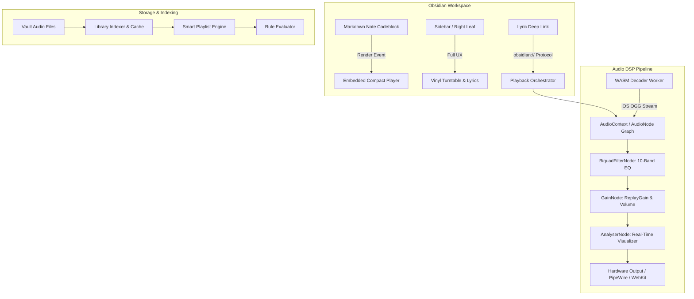

# Liber Music Player — Strategic Roadmap & Engineering Plan (v1.4.0 – v2.0.0)

> **Repository:** [`/home/liberprimus/code/liber_music`](file:///home/liberprimus/code/liber_music)  
> **Status:** Approved Architecture & Implementation Plan  
> **Target Rating:** 10.0 / 10.0 (Undisputed Audiophile & PKM Benchmark)  

---

## Executive Vision

While **`liber_music` v1.3.8** delivers an audiophile-grade skeuomorphic vinyl player with synchronized karaoke lyrics, 92.7% test coverage, and complete Android/iPadOS MediaSession support, the next evolution transforms the plugin from a *sidebar utility* into a **deeply integrated Personal Knowledge Management (PKM) audio environment**.

This roadmap establishes the phased engineering plan for six strategic pillars:
1. **PKM & Obsidian Deep Note Integration** (Codeblock embeds, lyric deep-linking, daily note logging)
2. **Web Audio DSP Engine** (10-Band Equalizer, gapless playback, crossfading)
3. **Reactive Visuals & Dynamic Aesthetics** (Cover art palette sampling, audio spectrum visualizer)
4. **Smart Library Automation** (Rule-based playlists, folder-to-playlist auto-sync, tag editor)
5. **Universal iOS Codec Parity** (WASM-based OGG Vorbis decoder for iPadOS/iOS)
6. **Distribution & Performance Engineering** (Bundle tree-shaking, automated tag releases)

---

## Architecture Blueprint



---

## Pillar 1: PKM & Obsidian Note Deep Integration

### 1.1 Interactive Markdown Codeblock Player (`music`)
* **Objective**: Render lightweight, interactive audio snippets directly within notes.
* **Syntax Specification**:
  ````markdown
  ```music
  track: "Music/Classical/Chopin - Nocturne Op. 9.mp3"
  start: "01:23"
  end: "03:45"
  showLyrics: true
  compact: true
  autoplay: false
  ```
  ````
* **Architecture**:
  * Register a Markdown codeblock post-processor via `Plugin.registerMarkdownCodeBlockProcessor("music", ...)`.
  * Mount a lightweight React or Vanilla DOM component rendered with minimal memory overhead.
  * Connect to the global `PlaybackService` to coordinate single-source playback (pausing the sidebar player if an in-note snippet is started).

### 1.2 Timestamped Lyric Deep-Linking & Protocol Navigation
* **Objective**: Enable students, researchers, and musicians to cite specific seconds of an audio track in their notes.
* **User Flow**:
  1. Hovering or right-clicking any line in the scrolling lyrics view displays a *"Copy Timestamp Link"* action.
  2. Generates a standard Obsidian URI:
     `obsidian://music-player?track=Music%2FSong.mp3&t=142`
  3. Clicking this link from any note instantly reveals the music player, loads the track, and seeks to second `142`.

### 1.3 Daily Notes Listening History & Scrobbler
* **Objective**: Automated life-logging of listening activity into PKM journals.
* **Configuration**:
  * Setting: `Record listening history to Daily Notes` (Toggle).
  * Automatically appends completed tracks (played past 70% duration) under a configurable heading (e.g., `## 🎧 Music Log`):
    `- 14:23 — **Bohemian Rhapsody** by *Queen* ([link](obsidian://music-player?track=...))`
  * Optional offline JSON logging (`.obsidian/plugins/liber-music-player-plugin/history.json`).

---

## Pillar 2: Audiophile Sound Engine (Web Audio API)

### 2.1 10-Band Graphic & Parametric Equalizer
* **Objective**: Audiophile acoustic tuning tailored to headphones and room environments.
* **Frequency Bands**:
  `31Hz`, `62Hz`, `125Hz`, `250Hz`, `500Hz`, `1kHz`, `2kHz`, `4kHz`, `8kHz`, `16kHz`
* **Presets**:
  * *Flat / Bypass*
  * *Bass Boost*
  * *Vocal & Podcast Clarity*
  * *Acoustic & Classical*
  * *Rock & Metal Punch*
  * *Electronic / Harman Curve*
* **Implementation**:
  * Route `HTMLAudioElement` through `AudioContext.createMediaElementSource()`.
  * Chain 10 `BiquadFilterNode` instances (`peaking`, `lowshelf`, `highshelf`).
  * Persist custom EQ curves in `settings.eqProfiles`.

### 2.2 Gapless Playback & Configurable Crossfading
* **Objective**: Eliminate silent micro-gaps between songs; smooth ambient transitions.
* **Design**:
  * Dual-audio-node buffer architecture: while Track A reaches `duration - crossfadeDuration`, begin pre-loading and fading in Track B.
  * Configurable crossfade duration: `0s` (strict gapless) to `10s` (club/ambient blend) with linear or exponential gain curve.

---

## Pillar 3: Reactive Visuals & Dynamic Aesthetics

### 3.1 Dynamic Accent Palette Extraction (Album Art Theming)
* **Objective**: The player's aesthetic transforms dynamically to mirror the artwork of the playing album.
* **Technical Plan**:
  * Use an offscreen canvas to quantize the album artwork into 3 dominant colors: `primaryAccent`, `secondaryAccent`, `surfaceDark`.
  * Set CSS variables on `.music-player`:
    * `--player-dynamic-accent`
    * `--player-dynamic-glow`
    * `--player-karaoke-highlight`
  * Smooth 600ms CSS transitions when shifting between album aesthetics.

### 3.2 Real-Time Audio Spectrum / Groove Visualizer
* **Objective**: Hypnotic, musical audio reactive visual feedback.
* **Components**:
  * Connect a Web Audio `AnalyserNode` (`fftSize = 128` or `256`).
  * Render an animated circular frequency wave pulsing along the edge of the vinyl disc or a sleek 32-bar graphic visualizer below the tonearm.

### 3.3 Custom Turntable Materials & Faceplates
* User-selectable turntable body styles in settings:
  1. **Vintage Walnut**: Rich mahogany wood grain with brass tonearm.
  2. **Brushed Obsidian**: Modern stealth dark matte aluminum with neon indicator LEDs.
  3. **Cyberpunk Acrylic**: Semi-transparent frosted glass with dynamic underglow.

---

## Pillar 4: Smart Library Automation & Dynamic Playlists

### 4.1 Rule-Based Smart Playlists
* **Query Engine**:
  * Users create playlists defined by logical criteria:
    * `Rating >= 4`
    * `PlayCount > 10`
    * `Year >= 1970 AND Year <= 1979`
    * `Genre CONTAINS "Jazz"`
    * `DateAdded WITHIN last 14 days`
  * Playlists re-evaluate dynamically on vault scan without manual curation.

### 4.2 Automated Folder-to-Playlist Sync
* Setting: `Treat top-level music folders as playlists`.
* A folder like `Music/Workout/` automatically surfaces as a "Workout" playlist in the sidebar without duplicate indexing.

### 4.3 In-App ID3 / Vorbis Metadata Editor
* Modal UI to inspect and correct missing tags (Title, Artist, Album, Year, Track Number) directly from the Obsidian context menu, writing changes back to disk or plugin index.

---

## Pillar 5: Universal iOS/iPadOS WASM OGG Decoder

* **The Problem**: Apple WebKit strictly refuses to decode Ogg Vorbis in standard HTML5 `<audio>`.
* **The Solution**:
  * Integrate an ultra-lightweight WebAssembly decoder (`stbvorbis.wasm` / ~45KB).
  * On iOS/iPadOS, when encountering `.ogg` or `.opus` files, route raw binary array buffers through WebAssembly decoding into a Web Audio `AudioBufferSourceNode`.
  * Achieves **100% format parity on iPad and iPhone** without requiring users to convert files.

---

## Pillar 6: Distribution & Performance Optimization

### 6.1 Bundle Size Tree-Shaking (Target: < 2.0MB)
* **Current State**: `dist/main.js` is ~6.6MB primarily due to full inclusion of `music-metadata` parsers.
* **Optimization**:
  * Modularize and lazy-load format-specific decoders.
  * Tree-shake unused polyfill routines and utilize native browser streaming APIs where available.

### 6.2 Automated Tagged Release Workflow
* Configure `.github/workflows/release.yml`:
  * Triggered on git tag push (`git tag v1.4.0 && git push origin v1.4.0`).
  * Automates test suite run, type check, bundle build, and attaches `main.js`, `manifest.json`, and `styles.css` directly to the GitHub release.
  * Allows instantaneous distribution via Obsidian **BRAT** (Beta Reviewers Auto-update Tester).

---

## Implementation Milestones

```
+-----------------------------------------------------------------------------------+
|                                 RELEASE MILESTONES                                |
+-----------+-----------------------------------------------+-----------------------+
| Version   | Scope / Major Deliverables                    | Primary Focus         |
+-----------+-----------------------------------------------+-----------------------+
| **v1.4.0**| Markdown Codeblock Embeds + Lyric Deep Links  | PKM Integration       |
| **v1.5.0**| Web Audio 10-Band EQ + Gapless/Crossfade      | Audiophile Sound      |
| **v1.6.0**| Dynamic Color Tinting + Audio Visualizer      | Aesthetic Polish      |
| **v1.7.0**| Smart Playlists + Vault Folder Auto-Sync      | Library Automation    |
| **v1.8.0**| WASM OGG Vorbis Decoder for iPadOS/iOS        | Universal Mobile      |
| **v2.0.0**| Tree-shaken Bundle (<2MB) + Release Pipeline  | Production Milestone  |
+-----------+-----------------------------------------------+-----------------------+
```

---

## Definition of Done (DoD) per Milestone
- [ ] TypeScript strict mode (`tsc -noEmit`) passes with 0 warnings.
- [ ] Automated Vitest suite coverage maintained above **92% line coverage**.
- [ ] No regressions in mobile touch ergonomics, memory ceiling, or MediaSession integration.
- [ ] Documented in both [`README.md`](file:///home/liberprimus/code/liber_music/README.md) and [`IMPROVEMENT_PLAN.md`](file:///home/liberprimus/code/liber_music/IMPROVEMENT_PLAN.md).
